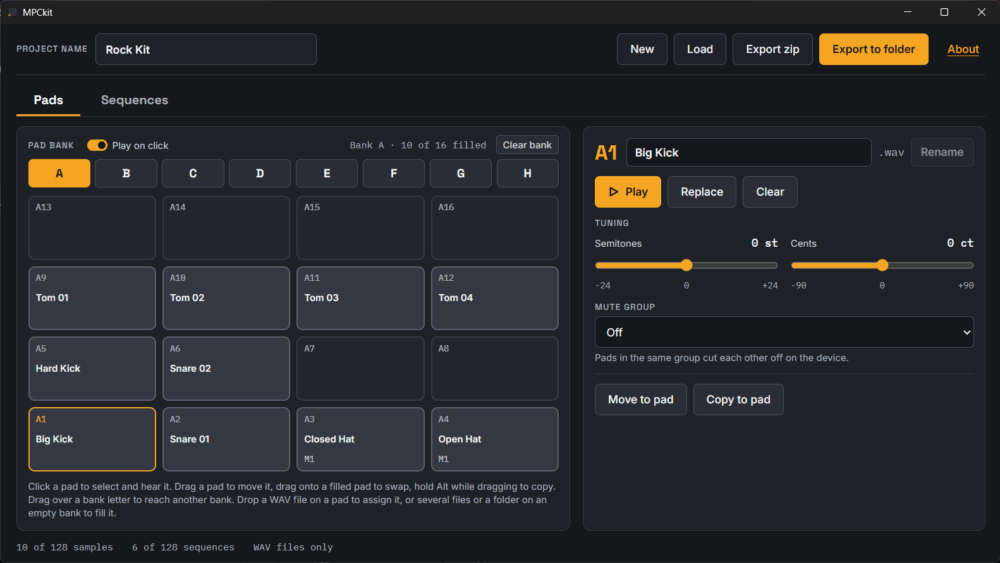
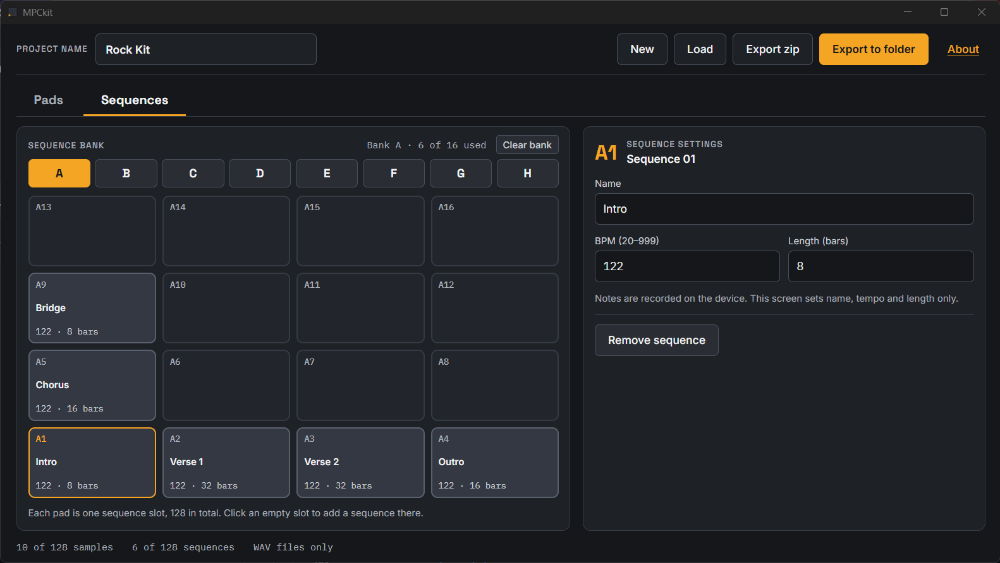

# MPCkit

[](https://github.com/bajdev/MPCkit/actions/workflows/build.yml)
[](https://github.com/bajdev/MPCkit/releases)
[](LICENSE)
[](#mpckit)


[](src/go.mod)
[](https://v3.wails.io)
[](https://svelte.dev)

**Build Akai MPC Sample projects on your computer.**

Drop WAV files onto pads, tune them, set mute groups and sequences, then export a project the MPC Sample opens as it is. MPCkit can also open a project saved on the device, so you can change it on a bigger screen and send it back.

**[Download MPCkit](https://github.com/bajdev/MPCkit/releases/latest)** for Windows, macOS or Linux. It's free.

> **Beta.** MPCkit is in testing (version 0.5). Expect a few rough edges, and keep a copy of any project you care about before opening it in MPCkit.



## Features

- **Pads and banks.** All 128 pads, in eight banks of 16. Drop a WAV file on a pad to assign it, or several files or a folder on an empty bank to fill it. Click a pad to hear it, and drag pads to move, swap or copy them.
- **Tuning and mute groups.** Tune each pad by up to 24 semitones and 90 cents either way. Put pads in mute groups so they cut each other off, as on the device.
- **Sequences.** Up to 128 sequences, each with a name, a tempo (20–999 BPM) and a length in bars. You record the notes on the device.
- **Open and export.** Open a project saved on the device, change it, and export it to a folder (for example straight onto the card) or to a zip.
- **Small, native and offline.** One small app for Windows, macOS and Linux. No installer, no account and no tracking. MPCkit never connects to the internet: your samples and projects stay on your computer.



Not in MPCkit yet: trimming samples with a waveform, level and pan, loop and trigger modes, effects, and editing recorded notes.

## Download and install

Download the file for your computer from the **[latest release](https://github.com/bajdev/MPCkit/releases/latest)**:

| Your computer | File to download |
| --- | --- |
| Windows 10 or 11 (64-bit) | `mpckit-<version>-windows-amd64.zip` |
| Mac (Apple silicon or Intel) | `mpckit-<version>-macos-universal.zip` |
| Linux (64-bit) | `mpckit-<version>-linux-amd64.tar.gz` |

MPCkit isn't signed yet, so your computer warns you the first time you open it. This is expected:

- **Windows:** unzip and run `mpckit.exe`. If you see "Windows protected your PC", choose **More info**, then **Run anyway**.
- **Mac:** unzip and move `mpckit.app` to Applications, then open it. When macOS blocks it, open **System Settings → Privacy & Security** and choose **Open Anyway**.
- **Linux:** extract and run `./mpckit`. It needs GTK 4 and WebKitGTK 6.0; on Debian and Ubuntu, install them with `sudo apt install libgtk-4-1 libwebkitgtk-6.0-4`.

## Getting your project onto the MPC Sample

When you export, MPCkit writes two things side by side:

```
MyKit.xpj
MyKit_[ProjectData]/      the samples your project uses
```

Copy **both**, together, to the MPC Sample's storage, then load `MyKit` on the device. The project's name comes from these two names, so rename a project only inside MPCkit.

## Found a bug or have an idea?

[Open an issue](https://github.com/bajdev/MPCkit/issues). Results from trying MPCkit's projects on a real MPC Sample are especially welcome.

## For developers

MPCkit is written in Go with [Wails v3](https://github.com/wailsapp/wails), and its window in Svelte and TypeScript.

To build it, you need Go (the version in `src/go.mod`), Node.js 22 or newer, and the Wails v3 CLI at the version in `src/go.mod`. On Linux you also need the GTK and WebKitGTK development packages; `wails3 doctor` lists anything missing.

```sh
go install github.com/wailsapp/wails/v3/cmd/wails3@v3.1.0   # match src/go.mod
cd src
wails3 dev          # run with live reload
wails3 build        # build for this system into src/bin/
go test ./...       # run the tests
```

What's where:

```
src/      the app: Go code, Svelte frontend, Wails build files, test projects
docs/     project file format notes, plans and screenshots
.github/  CI: builds for all three systems on every pull request and tag
```

Pull requests are welcome; see [CONTRIBUTING.md](CONTRIBUTING.md) first.

## License and disclaimer

MPCkit is [MIT licensed](LICENSE).

MPCkit is an independent project. It is not affiliated with, endorsed by or supported by Akai Professional or inMusic Brands. Akai, MPC and MPC Sample are trademarks of their respective owners and are used here only to describe the device MPCkit works with.
